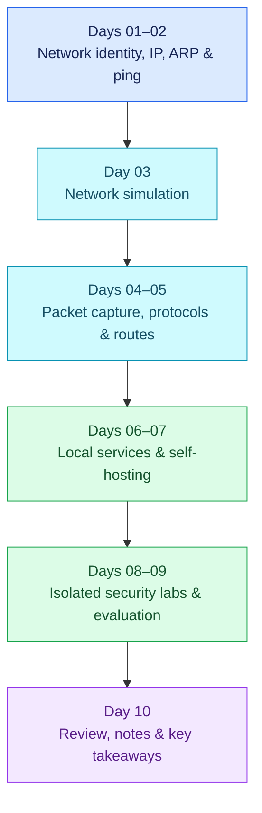

# 🌐 10-Day Networking & Protocol Fundamentals Lab

[](LICENSE)


Build practical networking knowledge in ten focused days. This hands-on roadmap
starts with Layer 2 and Layer 3 fundamentals, then progresses through network
simulation, packet capture, protocol analysis, and security-focused exercises in
authorized, isolated lab environments.

## Learning Roadmap



## Progress

**Status key:** ✅ Completed · 🔄 In Progress · ⏳ Pending

| Day | Focus | Status | Notes / exercise |
|---|---|---|---|
| 01 | Network identity: interface, MAC and IP addresses, subnet mask, gateway, and DNS | ✅ Completed | [Day 01 notes](logs/10-day-networking-notes.txt) |
| 02 | ARP, ping, and observing the address-resolution cache | ✅ Completed | [Day 02 notes](logs/10-day-networking-notes.txt) |
| 03 | Complete a network-simulation challenge | ✅ Completed | [Packet Tracer lab](labs/day-03-packet-tracer/basic-IPv4-Configuration-completed.pkt) |
| 04 | Explore packet capture and protocol analysis | ✅ Completed | [Progress notes](logs/10-day-networking-notes.txt) |
| 05 | Trace routes and study wireless-security concepts in a lab | ✅ Completed | [Progress notes](logs/10-day-networking-notes.txt) |
| 06 | Host a basic web page locally | ✅ Completed | [Day 06 web lab](day6-web/index.html) |
| 07 | Explore a self-hosted metasearch service | ⏳ Pending | [Roadmap](assets/10-days-roadmap.png) |
| 08 | Work through an isolated network-security lab | ⏳ Pending | [Roadmap](assets/10-days-roadmap.png) |
| 09 | Evaluate a deliberately vulnerable training environment | ⏳ Pending | [Roadmap](assets/10-days-roadmap.png) |
| 10 | Review the lab notes and summarize key learnings | ⏳ Pending | [Progress notes](logs/10-day-networking-notes.txt) |

## Day 6: Local Web Hosting

The static page in [`day6-web/index.html`](day6-web/index.html) can be served locally with Python:

```powershell
cd day6-web
python -m http.server 8080
```

Open `http://127.0.0.1:8080/` in a browser. Press `Ctrl+C` to stop the server.
The page was verified with a `200 OK` response and the server log recorded
`GET / HTTP/1.1 200`. Full execution and verification notes are in
[`logs/10-day-networking-notes.txt`](logs/10-day-networking-notes.txt).

> **Lab safety:** Perform hands-on exercises only on systems and networks you
> own or are explicitly authorized to use. Keep security experiments isolated
> from production and public networks.

## Tech Stack & Environment

- **Platform:** Windows with Windows PowerShell
- **Network diagnostics:** `ipconfig`, `ping`, `arp`, and `tracert`
- **Network simulation:** Cisco Packet Tracer
- **Packet capture and analysis:** Wireshark
- **Scripting and automation:** Python
- **Version control:** Git and GitHub

Tools are introduced as the roadmap progresses; the repository's notes record
completed exercises and observations.

## Repository Structure

```text
10-day-networking-lab/
├── assets/
│   └── 10-days-roadmap.png
├── day6-web/
│   └── index.html             # Local Python HTTP server test page
├── labs/                         # Workspace for hands-on lab material
├── logs/
│   └── 10-day-networking-notes.txt
├── LICENSE
└── README.md
```
